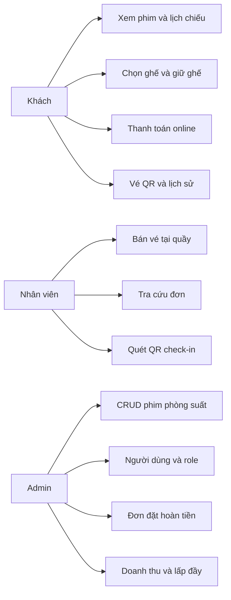
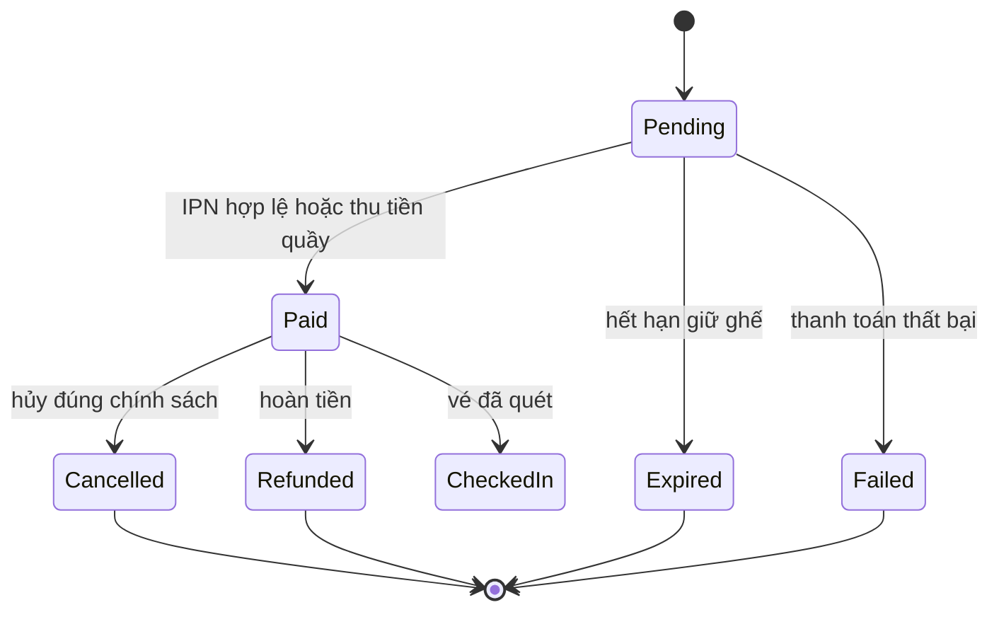
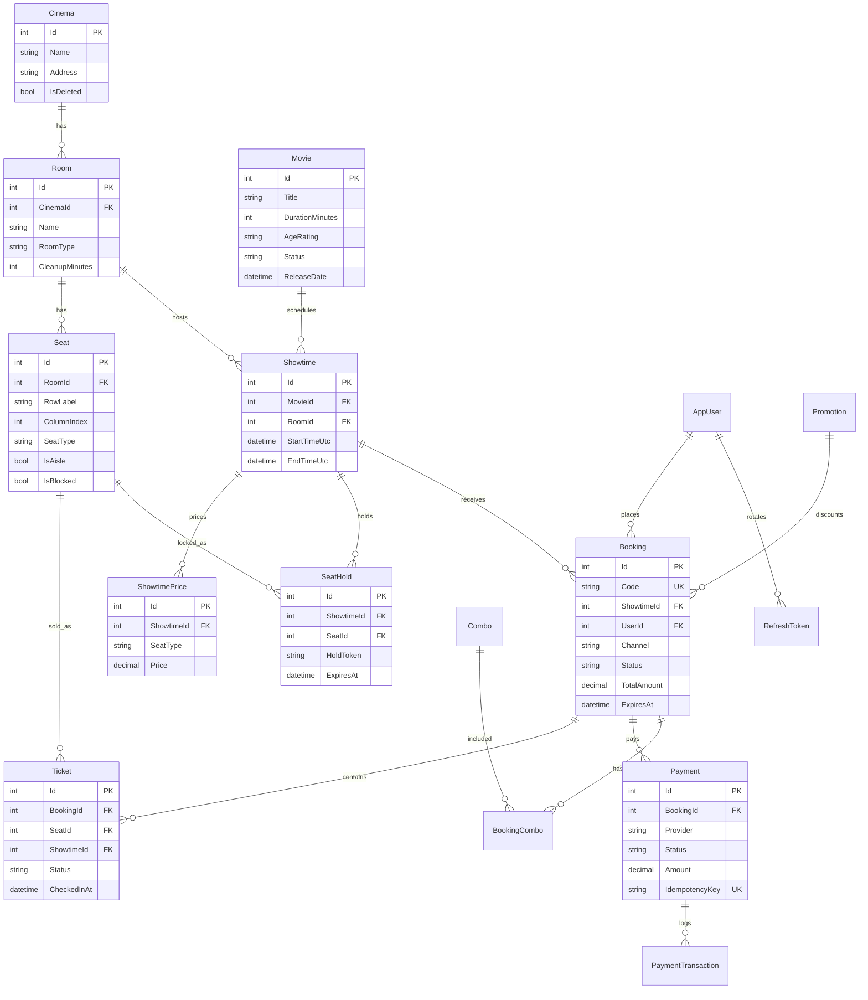

# Bước 1 — Phân tích và thiết kế

Thương hiệu riêng: **National Cinema**. Không dùng tên, logo hay nội dung của site tham chiếu.

Hai project hiện có được giữ và nâng dần, không tạo repo mới:

- Backend: `D:\HocDotNet\CinemaBookingSystem` (ASP.NET Core, Clean Architecture, hiện .NET 6)
- Frontend: `D:\HocDotNet\CinemaBookingVue` (Vue 3, Vite)

## Giả định

- Một rạp trước (`Cinema`), schema cho phép nhiều rạp sau.
- Giữ ghế 10 phút. Tối đa 8 ghế mỗi đơn. Hủy vé khi còn ít nhất 2 giờ trước giờ chiếu.
- Giao diện tiếng Việt. Tiền VND, `decimal(18,2)`. Lưu UTC, hiển thị UTC+7.
- Khóa chính giữ `int` trong các bước sửa trên code đang chạy. Đổi sang `Guid` là mục tiêu sau, vì đổi ngay sẽ gãy database và toàn bộ Vue đang gọi `id` số.
- Redis, SignalR, Hangfire, MediatR thêm ở các bước sau. Máy hiện chạy được với SQL Server; chưa bắt buộc Redis để app hiện tại sống.
- Thanh toán online đi qua interface cổng thanh toán. Sandbox trước, không hard-code secret.

## Lựa chọn kiến trúc

Giữ bốn project đang có và đổ thêm use case vào đó, thay vì dựng solution `Cinema.*` song song.

| Spec | Project hiện tại |
|---|---|
| Cinema.Domain | CinemaBooking.Domain |
| Cinema.Application | CinemaBooking.Application |
| Cinema.Infrastructure | CinemaBooking.Infrastructure |
| Cinema.WebApi | WebApplication1 (`CinemaBooking.API.csproj`) |

Lý do: API, migration và Vue đã nối với cấu trúc này. Viết solution mới sẽ có hai backend cùng lúc và frontend không biết gọi cái nào.

## Use case



## Vòng đời trạng thái



Ghế theo suất: `Available → Held → Sold`. Hết hạn giữ hoặc thanh toán thất bại thì `Held → Available`.

Vé: `Valid → CheckedIn` hoặc `Valid → Cancelled`.

Hiện tại enum booking chỉ có `Pending`, `Paid`, `Cancelled`. `Expired`, `Failed`, `Refunded` và trạng thái ghế `Held` sẽ thêm khi làm luồng giữ ghế.

## ERD



Ràng buộc bắt buộc khi code bước giữ ghế và thanh toán:

- Unique `(ShowtimeId, SeatId)` trên vé còn hiệu lực (`Valid`, `CheckedIn`), để hai request không bán cùng một ghế.
- Unique `(ShowtimeId, SeatId)` trên `SeatHold` còn hạn.
- Unique `Booking.Code`, unique `Payment.IdempotencyKey`.
- Suất chiếu không chồng lên nhau trong cùng phòng: `[StartTime, EndTime + CleanupMinutes)`.

## API mục tiêu

Prefix `/api/v1`. Response:

```json
{ "success": true, "data": {}, "error": null, "traceId": "" }
```

Lỗi: `error: { "code": "", "message": "", "details": [] }`.

| Nhóm | Method | Path | Quyền |
|---|---|---|---|
| Auth | POST | `/api/v1/auth/register` | Công khai |
| Auth | POST | `/api/v1/auth/login` | Công khai |
| Auth | POST | `/api/v1/auth/refresh` | Công khai, có refresh token |
| Auth | POST | `/api/v1/auth/forgot-password` | Công khai |
| Phim | GET | `/api/v1/movies` | Công khai |
| Phim | GET | `/api/v1/movies/{id}` | Công khai |
| Suất | GET | `/api/v1/showtimes?movieId&date` | Công khai |
| Ghế | GET | `/api/v1/showtimes/{id}/seats` | Công khai |
| Giữ ghế | POST | `/api/v1/showtimes/{id}/seat-holds` | Khách hoặc khách vãng lai |
| Giữ ghế | DELETE | `/api/v1/seat-holds/{holdId}` | Chủ hold |
| Đơn | POST | `/api/v1/bookings` | Chủ hold |
| Đơn | GET | `/api/v1/bookings/mine` | Customer |
| Thanh toán | POST | `/api/v1/payments/{bookingId}/url` | Chủ đơn |
| Thanh toán | POST | `/api/v1/payments/callback/{provider}` | Cổng thanh toán, xác thực chữ ký |
| Vé | GET | `/api/v1/tickets/{id}` | Chủ vé |
| Check-in | POST | `/api/v1/checkin/verify` | Staff |
| Check-in | POST | `/api/v1/checkin/confirm` | Staff |
| Quầy | POST | `/api/v1/staff/counter-sales` | Staff |
| Admin | * | `/api/v1/admin/movies|rooms|showtimes|users|bookings|reports|promotions` | Admin |

API đang chạy (chưa version) vẫn là hợp đồng của Vue hiện tại: `/api/Movies`, `/api/showtimes`, `/api/bookings`, `/api/admin/*`, `/api/staff/*`. Đổi sang `/api/v1` chỉ khi sửa backend và frontend trong cùng một bước.

## Luồng đặt vé online

1. Khách chọn phim, ngày, suất. Client tải sơ đồ ghế.
2. `POST /showtimes/{id}/seat-holds` khóa ghế (Redis `SETNX` + TTL, đồng thời ghi `SeatHold`). Trả `holdId`, `expiresAt`.
3. Hub SignalR phát `SeatStatusChanged`. Client khác thấy ghế đang giữ.
4. Xác nhận tạo `Booking` trạng thái `Pending`, gắn hold, chuyển cổng thanh toán.
5. IPN xác thực chữ ký, xử lý idempotent: `Paid`, ghế `Sold`, sinh vé và QR ký HMAC, gửi email.
6. Job nền nhả hold hết hạn và đơn `Pending` quá giờ.
7. Unique `(ShowtimeId, SeatId)` chặn đặt trùng khi hai request vào cùng lúc.

Bán quầy bỏ qua cổng online: thu tiền xong thì `Paid` ngay và xuất QR.

QR chỉ chứa token đã ký: `ticketId`, `bookingCode`, `showtimeId`, `exp`. Không nhét email, số điện thoại, giá.

Check-in: đúng chữ ký, đơn đã trả tiền, đúng suất, chưa quét, trong khung từ 60 phút trước giờ chiếu đến hết suất.

## Cấu trúc thư mục mục tiêu

Backend, bám project hiện có:

```text
CinemaBooking.Domain/        Entities, Enums, Exceptions
CinemaBooking.Application/   UseCases, DTO, Validators, Interfaces
CinemaBooking.Infrastructure/ EF Core, Identity, Payment, QR, Jobs
WebApplication1/             Controllers, Middleware, SignalR Hub
tests/                       xUnit cho giữ ghế, thanh toán, check-in
```

Frontend:

```text
src/api/           client HTTP duy nhất
src/stores/        auth, booking, seat
src/views/         public, admin, staff
src/components/    SeatMap dùng chung khách và quầy
```

Vue hiện là JavaScript, chưa có Pinia, Tailwind, TypeScript. Những thứ đó thêm theo từng màn, không đổi toàn bộ file trong một lần.

## Việc đã chốt cho bước code đầu

Mọi màn Vue gọi API qua `src/api.js` và `src/config.js`. Không còn URL `https://localhost:7106` trong từng trang. Proxy Vite trỏ `http://localhost:5065` trừ khi đặt `VITE_API_URL`.
